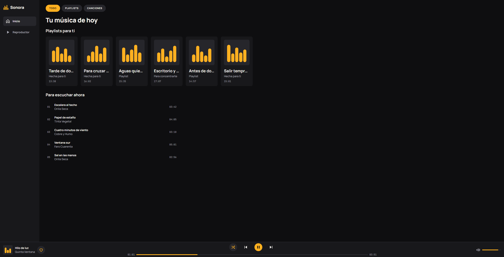
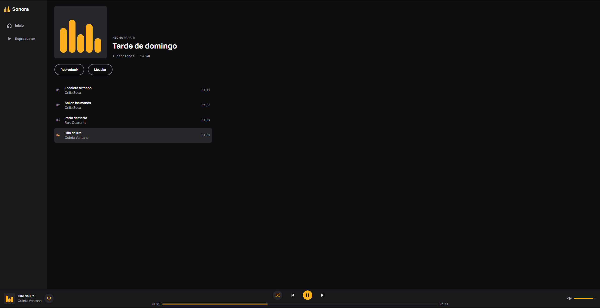
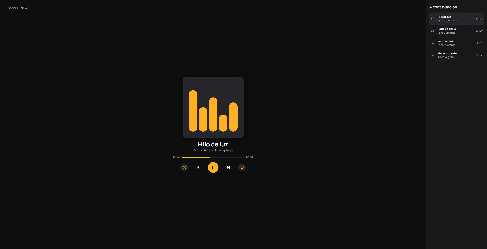
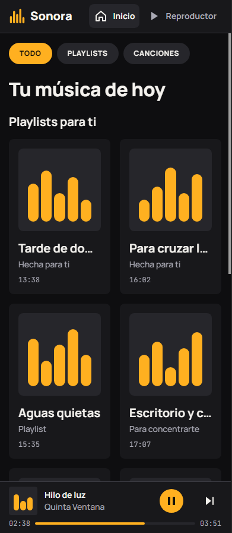
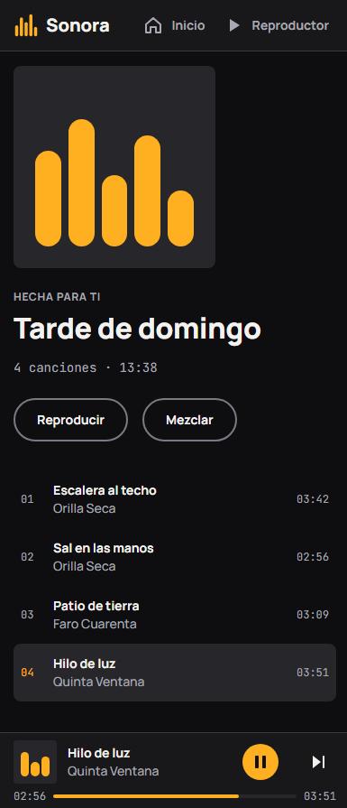
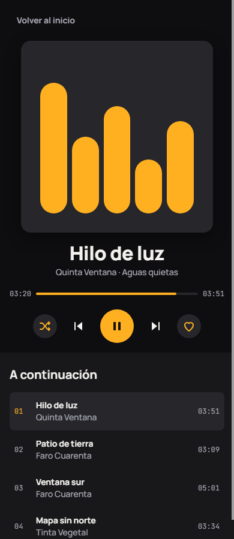

# Sonora

Frontend (solo vistas, sin backend ni audio real) de una app de música, hecho con Laravel 13, Blade y Tailwind CSS v4, siguiendo el sistema de diseño de la materia. Todos los artistas, canciones y playlists son inventados.

## Cómo ejecutarlo

Requisitos: PHP 8.3 o superior, Composer, Node.js y Laravel Herd (o `php artisan serve`).

```
composer install
npm install
copy .env.example .env
php artisan key:generate
npm run dev
```

Con Herd, el sitio queda en `http://sonora.test`. Sin Herd, en otra terminal: `php artisan serve` y abrir `http://localhost:8000`. Para una versión de producción: `npm run build`.

## Pantallas

| Ruta | Pantalla |
|---|---|
| `/` | Inicio: filtros, playlists para ti y canciones para escuchar ahora |
| `/playlist/{id}` | Playlist: cabecera, acciones y lista de canciones |
| `/reproductor` | Reproductor a pantalla completa con la cola |

Incluye tema claro (botón "Tema claro" del menú, en escritorio) y versión móvil de 390px. No incluye la pantalla Buscar.

## Estructura

- `config/sonora.php`: datos de ejemplo (canciones y playlists).
- `app/Http/Controllers/`: un controlador por pantalla.
- `app/Support/Tiempo.php`: formato de tiempos (mm:ss).
- `resources/views/components/`: componentes Blade (`button`, `icon-button`, `chip`, `media-card`, `song-row`, `cover`, `progress`, `player-controls`, `player-bar`, `sidebar`, `icon`, `logo`) y el layout `layouts/app`.
- `resources/css/app.css`: tokens de color de ambos temas, escala tipográfica y foco global.
- `resources/js/reproductor.js`: reproducción simulada.

## Reglas del sistema de diseño

- Solo tokens: la paleta de Tailwind se borra y ninguna vista usa colores en hexadecimal.
- Manrope y JetBrains Mono (tiempos y números).
- Un solo botón primario ámbar por vista.
- Foco visible en todo control y uso completo con teclado, incluidos los controles deslizantes (flechas, Inicio y Fin).
- Todo botón de solo icono lleva etiqueta.
- Textos en español, en minúsculas de oración y sin emojis.

## Reproducción simulada

No hay audio. El estado (cola, canción, volumen, favoritos y mezcla) se guarda en `localStorage` con la clave `sonora:estado` y el tiempo se calcula con una marca de tiempo, así la reproducción continúa al cambiar de pantalla. Para reiniciarla: `localStorage.removeItem('sonora:estado')`.

## Decisiones

- **Componentes planos** en `components/`, con los nombres del sistema y props en español. Se reutilizan: `song-row` (Inicio, Playlist y cola), `progress` (progreso y volumen), `player-controls` (barra y Reproductor), `cover` y `media-card`.
- **Tokens** con `@theme inline` de Tailwind v4, que borra la paleta por defecto, más una escala tipográfica propia (`text-title`, `text-body-sm`, etc.) y una regla global de foco.
- **Datos** en `config/sonora.php` y controladores invocables, sin base de datos.
- **Layout** con una opción `completa` que oculta el menú y la barra en el Reproductor, como el mockup del sistema.
- **Un primario por vista:** en Playlist, "Reproducir" es secundario y el único ámbar es el de la barra.
- **Reproducción:** `localStorage` más marca de tiempo; "Mezclar" reordena la cola para que lo que se ve sea lo que suena.
- **Móvil:** el menú pasa a una cabecera superior y el reproductor se reduce a reproducir y siguiente.
- **Qué cambiaría con más tiempo:** la pantalla Buscar, pasar los datos a base de datos con Eloquent y probar los componentes con pruebas automáticas.






